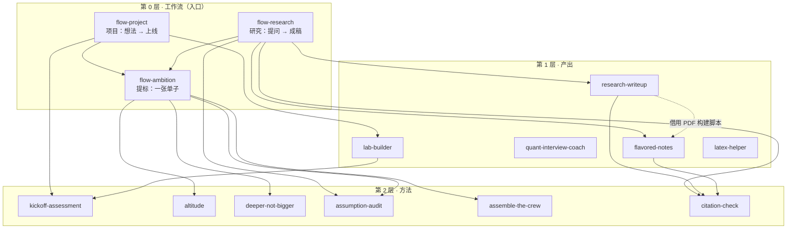

# 我的 Skills · 分层工作流

这里是我给 Claude 写的 skill（可复用的做事规程），共 14 个，分三层：

- **第 0 层 · 工作流**（3 个）：入口，负责顺序、每轮只问一次、关口核验；
- **第 1 层 · 产出**（5 个）：各种交付物怎么做——实验室、研究总结、风格笔记、LaTeX、面试陪练；
- **第 2 层 · 方法**（6 个）：工作流和产出共用的做事方法——评估、提标、检验、组队、核引用。

调用只往下走。同层之间只有两处：flow-project 和 flow-research 会调 flow-ambition；research-writeup 借用 flavored-notes 的 PDF 构建脚本。

目录名以下划线开头，GitHub Pages 不发布它（网站上看不到），在 GitHub 上照常可见。

## 一张图

实线箭头表示“会调用”。latex-helper 和 quant-interview-coach 不在任何工作流里，单独用。

## 怎么用

### 三条工作流

| 工作流 | 什么时候用 | 怎么叫 | 会发生什么 | 你要做的 |
|---|---|---|---|---|
| `flow-project` | 有个新项目想法（游戏、互动页、实验室、agent、工具），想从评估一路推进到上线 | “用 flow-project 推进 ××”，或“从评估到上线带我走一遍” | 盘点 → 评估 → 提标（可选）→ 样本（过独立试玩）→ 铺开（过抽查）→ 合并 | 每轮批一张批示单；说“合并”才会合并 |
| `flow-research` | 一个研究问题要跨几个 skill 才能做完：既写又用数据检验结论、先提标再写、要走完整流程出存档成稿 | “用 flow-research 写 ××” | 分流 → 写第一版 → 核引用 → 检验（有数据时）→ 独立审稿 → 出 PDF → 随追问生长 | 看成稿，追问；只有真有歧义、要提标或要检验时，动笔前才给你批示单 |
| `flow-ambition` | 想把手上一件事往大了做，或同时要往上抽、做深、检验假设、多领域一起看 | “往大了做 ××”“提标”“用 flow-ambition” | 四个方法各自分析，合成一张提标单；批完按选定的条目执行 | 批一张提标单 |

例子：

- “我想做一个看星空认星座的网页小游戏，给初中生用。用 flow-project 带我走一遍。”
- “用 flow-research 把 Atiyah–Bott 的 Yang–Mills 那套理论写成一份能存档的成稿。”
- “下周给导师汇报这学期的进展，帮我准备十页幻灯片。往大了做。”

### 单独用

每个 skill 都可以单独触发，工作流只在要走完整流程时才需要：

- 只要一份总结或笔记：“总结一下 ××”会直接用 `research-writeup`，“用费曼的风格写 ××”会直接用 `flavored-notes`，它们自带核引用、审稿和 PDF。
- “这个符号怎么打”直接用 `latex-helper`；“先评估一下，先别建”直接用 `kickoff-assessment`；面试准备和陪练用 `quant-interview-coach`。
- 只想做深、按顶尖标准做 → `deeper-not-bigger`；只想往上抽一层 → `altitude`；手上有数据、想检验一个说法 → `assumption-audit`；要多个领域一起看 → `assemble-the-crew`。
- 给已有实验室修 bug、加按钮这类小改动，`lab-builder` 直接改源码、构建、跑检查、开 PR。
- 一两句话就能答的快问题，直接回答，不出文档也不走流程。

单独用一个方法时，它也只停一次：要你决定的事放在同一张单子上。想把几个方法串起来，用 `flow-ambition`。

### 总控协议（三个工作流共用）

1. **先看再问**：先查对话里的文件、记忆、已连接的应用、仓库和之前的批示文档，能查到的不问。
2. **一轮一张批示单**：每轮要你拍板的事合成一张单子，逐条编号，你逐条批（采纳 / 改后采纳 / 暂缓 / 不做）。4 条以内用提问工具，更多用“逐条批示版”文档。
3. **原任务保底**：你原来要的东西照交；提标只加不换；发送、发布、删除、部署、合并、花钱、建定时任务都先问。
4. **关口过独立核验**：流水线里写了关口的地方，成品交给一个没看过过程的子 agent 去审，结果分成已修 / 接受风险 / 需要你决定。没有子 agent 时，给你一段能粘贴进新会话的审查提示。
5. **没人在场时**：按推荐项只做可逆的部分，开头写明按哪种理解做的；项目最远做到“样本过关口”（学习、游戏类页面就是样本过独立试玩，样本发成私有 Artifact）。推送到公开仓库、合并、删除、对外发送都停在决定前。
6. **小任务直通**：一两句话的小事不走流程。
7. **记进度**：跨轮的工作有一张“进度”表，回来时从停下的地方接着做。
8. **环境不够就交接**：跑不了代码、读不到数据时，交一段能直接粘贴进 Claude Code 的提示。

## 全部 skill

| 层 | skill | 做什么 | 版本 |
|---|---|---|---|
| 0 工作流 | `flow-project` | 项目从想法到上线：评估、提标、样本、铺开、合并 | v1 |
| 0 工作流 | `flow-research` | 研究问题从提问到成稿：写、核、验、审、交付 | v1 |
| 0 工作流 | `flow-ambition` | 把四个提标方法合成一张提标单，批完再执行 | v1 |
| 1 产出 | `lab-builder` | 浏览器实验室与小游戏的建造规程，样本过独立试玩，小改动直通 | v2 |
| 1 产出 | `research-writeup` | 跨学科研究级总结：四问纲领、命题台账、独立审稿、PDF | v2 |
| 1 产出 | `flavored-notes` | 指定风格的数学物理笔记（PDF + Markdown），带风味盲测 | v2 |
| 1 产出 | `latex-helper` | 自然语言描述 → 可粘贴的 LaTeX | v1.1 |
| 1 产出 | `quant-interview-coach` | 量化面试准备、限时陪练（只判不答）、面完复盘 | v2 |
| 2 方法 | `kickoff-assessment` | 新项目先评估、不开工；有压力测试模式 | v2 |
| 2 方法 | `altitude` | 往上抽一层：四层阶梯，每层有工作量和裁判，推荐层附首个探针 | v2 |
| 2 方法 | `deeper-not-bigger` | 按顶尖从业者的材料、方法和可查的标准重写任务 | v2 |
| 2 方法 | `assumption-audit` | 用原始材料检验默认结论：先封存留出集、跑规格网格、隔离的对手 | v2 |
| 2 方法 | `assemble-the-crew` | 跨领域团队加红队盲审 | v2 |
| 2 方法 | `citation-check` | 引用核验的唯一规则：什么算核实、预算、台账 | v1 |

每个 skill 的目录里：`SKILL.md` 是规程本身，文末有版本记录；`evals/` 是测试题（见“维护”）。flavored-notes 另有 `scripts/`（PDF 构建脚本，research-writeup 也用）、`references/`（风味表）和 `assets/`（示例源文件）。

## 安装与同步

仓库里按层分目录，而 claude.ai 和 Claude Code 都要求每个 skill 是一个平铺的 `名字/SKILL.md` 文件夹，所以安装时要“拍平”。

**claude.ai（网页、桌面、手机）**

- 推荐：在对话里请 Claude 为改过的 skill 出“保存 skill”的卡片，点保存。
- 卡片里只有 `SKILL.md`。flavored-notes 还带着脚本和参考文件：用卡片保存之后，看一眼它的 `scripts/` 和 `references/` 还在不在。不在也能用——flavored-notes 和 research-writeup 会退回普通 Markdown，用 pandoc 出 PDF，排版简单一些；要完整版就按下一条用压缩包上传。
- 压缩包：在仓库根目录运行 `python3 _skills/tools/sync_skills.py pack ~/Desktop/skills-zip`，再到 claude.ai 的设置里逐个上传。压缩包要放在仓库外面（仓库里不放压缩包）。
- 自己上传的 skill 在技能列表里有时显示成 `anthropic-skills:名字`，工作流按名字找，不受影响。

**Claude Code**

- `python3 _skills/tools/sync_skills.py install`：装到 `~/.claude/skills/`；同名的旧版本先挪进旁边的 `~/.claude/skills-backup/时间戳/`。加 `--dry-run` 只看会装什么，加 `--only 名字` 只装某几个。
- `python3 _skills/tools/sync_skills.py list`：列出全部 skill 和版本。

## 维护

- **改一个 skill**：批示 → 改 `SKILL.md` → 改或加测试题 → 文末版本记录加一条 → 跑检查 → 开 PR（规矩见仓库根目录 `CLAUDE.md`）。
- **检查**：`python3 _skills/tools/check_skills.py`（自动检查的“规矩检查”一项也会跑它）。它查名字和描述是否合规、有没有版本记录和版权行、测试题是否齐全、三个工作流的总控协议是否一致、这份说明是否列出了每个 skill。
- **测试题**：每个 skill 的 `evals/` 里有至少 3 道任务题（skill-creator 的用例格式：`prompt.md`、`case.yaml`、`graders/`，带输入文件的还有 `files/` 和 `place-files.sh`）和 `trigger_eval.json`（10 句该触发或不该触发的问法，一半是容易混淆的近邻）。测试用的数据和背景都是合成或虚构的，文件里写明了。
  - 在对话里：请 Claude 用 skill-creator 跑某个 skill 的测试题。
  - 有 Claude Code 的话：先用上面的 `install` 把全部 skill 装上（工作流的题会调用下层的 skill），再在某个 skill 的目录里运行 `claude plugin eval . --allow-tools Write,Edit,Bash --scaffold`。这是真实计费的运行；结果写在该 skill 的 `evals/results/` 里，不提交（`_skills/.gitignore` 已排除）。
- **总控协议**：三个工作流里的那一段要逐字相同，改的时候三处一起改。
- **暂缓的改动**（2026-10-28 批示时暂缓）：LB1 试玩脚本进自动检查；LB4 机制库每类一页模板；LH1 先编译再给、交换图附渲染图；LH2 测 latex-helper 的触发率；LH3 个人宏文件；DN3 “沉淀”走更新卡片、专家工具表设上限；AC1 子 agent 任务书固定格式；AC3 最小团队与用量。

## 没收进来的 skill

账户里另外 14 个是从别人的仓库导入的，各有自己的许可证，不收进这里：

- [tradermonty/claude-trading-skills](https://github.com/tradermonty/claude-trading-skills)：backtest-expert、options-strategy-advisor、position-sizer、residual-edge-analyzer、trade-hypothesis-ideator
- [wshobson/agents](https://github.com/wshobson/agents)：backtesting-frameworks、risk-metrics-calculation、quant-analyst
- [K-Dense 科研技能库](https://github.com/K-Dense-AI/claude-scientific-skills)：qiskit、pennylane、qutip、sympy、scientific-schematics
- persona（Hajime Takeda，MIT）

按 2026-10-28 的批示：回测类以 backtest-expert 为主，backtesting-frameworks 的描述收窄为“写回测框架代码”，quant-analyst 停用；scientific-schematics 要用就放行 openrouter.ai 并提供 key，不用就停用。

---

© 2026 Zechen Bian · All rights reserved / 保留所有权利。非开源，见仓库根目录 LICENSE。
